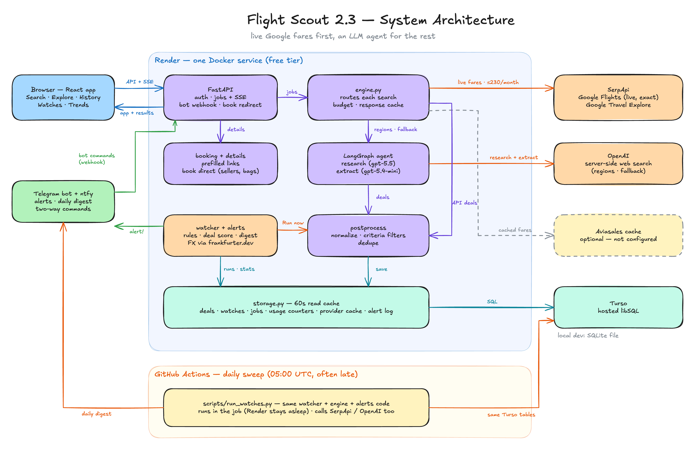

# Flight Scout — Architecture

End-to-end: a LangGraph agent that searches the live web for flight deals, a FastAPI backend that runs it as background jobs and serves the React UI, a Turso (libSQL) database, and a GitHub Actions cron that re-checks watched routes daily and pushes alerts.

## System overview



*Diagram source: [docs/architecture.excalidraw](./docs/architecture.excalidraw) — open it at [excalidraw.com](https://excalidraw.com) to edit.*

Everything server-side lives in **one process** on one free Render instance: the API, the agent, the watcher, and the static frontend. There is no queue, no worker fleet, no scraping infrastructure — the design goal is the smallest system that does the job on free tiers.

## The LangGraph agent (`backend/app/agent.py`)

The agent is a two-node `StateGraph`:

```
START ──▶ research ──▶ extract ──▶ END
          (LLM + server-side       (structured-output pass →
           web search → prose)      validated FlightDeal list)
```

State flowing through the graph (`AgentState`):

```python
origin: str            # "TLV" (or a comma list)
destination: str       # "Prague", a country/region ("Greece"), a comma list, or "anywhere"
dates_hint: str        # free text: "October 11 week", "a weekend in November"
params: SearchParams   # structured criteria: trip type, passengers, cabin class, max stops,
                       # date window + trip length, bags, max price, currency, nearby airports
research_notes: str    # output of node 1, input of node 2
deals: list[FlightDeal]  # final output
```

`SearchParams` (in `models.py`) is the one contract shared by the agent, storage, booking links and the UI. It is persisted with every stored deal, so re-runs and booking links reproduce the exact party and criteria.

### Node 1 — `research`

One LLM call with the provider's **server-side web search tool** bound. The searching loop (issue queries, fetch pages, read results) runs entirely on the provider's infrastructure and the node gets back a single prose answer — no client-side tool loop, no scraper, no flight-API keys:

- **Anthropic**: `web_search_20260209` (10 uses, 14 for flexible/region searches) plus `web_fetch_20260209` (5 uses) to open result and airline pages and confirm exact dated fares. A long server-side tool loop that pauses (`stop_reason: pause_turn`) is continued up to twice.
- **OpenAI**: `{"type": "web_search"}` — requires the Responses API (`ChatOpenAI(use_responses_api=True)`)

The prompt is built from every `SearchParams` field plus today's date. It asks for exact dated fares from Google Flights, Skyscanner, Kayak, Momondo and airline sites over "from" teasers, and a fixed report format per deal: IATA airports, times, flight numbers, fare for the whole party with the per-person breakdown, and bag fees added when bags are required. Region/"anywhere" destinations become an explore search across several airports.

### Node 2 — `extract`

A second, cheaper LLM pass over the research notes using LangChain's `with_structured_output(FlightDealList)` — the model is forced to emit the Pydantic schema, so the output is validated data, not parsed prose. Two safety nets sit on top of the model:

- **Criteria are enforced in code** (`postprocess()`): max stops, max price (after currency conversion), departure window, trip length, one-way vs round trip, no past dates, no non-positive prices. On a round-trip search, a fare that is clearly one-way is doubled and marked `estimated`, before the budget check. Within-run duplicates are merged (best `price_confidence`, then cheapest) and results are sorted by price in the preferred currency. The prompt asks; the code guarantees. Deals that can't be checked (free-text dates, unknown currency) are kept.
- **Honest confidence**: every deal carries `price_confidence` — `verified` (exact fare seen for these dates), `estimated` (computed, e.g. fare + bag fee), or `from_price` (a "from X" teaser).
- **Currency codes are normalized by a Pydantic validator** on `FlightDeal` (`"₪"` → `ILS`, `"$"` → `USD`, ...). The same model validates rows read back from the DB, so old mis-coded rows heal on read.

### Why two passes?

A single call can't reliably do both jobs: web search needs a free-form response the model can reason in, while storage needs strict schema. Splitting them also means the second pass can run on the same cheap model with no tools bound. A full search costs **two model calls**; cost depends mostly on the model (`FLIGHT_SCOUT_MODEL`, production runs `gpt-5.5`).

### Provider selection

`_provider()` picks the provider at call time: `FLIGHT_SCOUT_PROVIDER` env override → `ANTHROPIC_API_KEY` present → `OPENAI_API_KEY` present. Default models: `claude-opus-5` / `gpt-5.4-mini`, overridable with `FLIGHT_SCOUT_MODEL`.

## Real fare data (`backend/app/engine.py`, `backend/app/providers/`)

The LLM agent is no longer the only source. `engine.search()` sits in front of it and routes each request to the cheapest source that can answer it:

| Request | Source(s) |
|---|---|
| No fare-API keys | LLM agent, unchanged |
| One origin + one destination (airport or metro), exact dates | **SerpApi Google Flights** (live, exact); on budget exhaustion / error → Aviasales cache for those dates |
| Exact route, flexible dates ("November", a window, "anytime") | **Aviasales calendar** (one free call per month of the window) → cheapest 3 date pairs → top 2 confirmed live on Google Flights; other cached dates shown as cached |
| Region, country, "anywhere", comma list, nearby airports | LLM agent, seeded with the cheapest **Aviasales explore** sightings as leads; sightings that provably match (country / list / anywhere) are shown too |
| Nothing found by the APIs | LLM agent as last resort (if an LLM key is set) |

Every provider deal goes through the same `agent.postprocess` (normalize + criteria filters + dedupe) as the agent's. Deals carry `source` (`google_flights` / `aviasales` / `web`) and `seen_at`; the job carries `meta` (sources, Google `price_insights`, live searches spent, notices).

**Mapping caveats.** SerpApi prices are the total for the passengers sent (adults/children/lap infants) in the requested currency; on round trips the outbound list already shows the round-trip total, and return-leg times need one more search with the itinerary's `departure_token` (off by default, `SERPAPI_RETURN_LEGS`). `bags=N` adds carry-on fees; checked bags have no filter, so those fares are marked `estimated` with a note. Aviasales prices are per adult, economy, no bags, from other users' searches: multiplied by paying travellers (+~10% per lap infant), always `estimated` (`from_price` if seen over a week ago), booking link = `aviasales.com` + `link` + `marker`.

**Budget & cache.** `provider_usage` counts uncached calls per provider per calendar month (UTC); SerpApi stops at `SERPAPI_MONTHLY_BUDGET` (default 230 of the free 250) and searches fall back to cached fares / the web with a notice. `provider_cache` stores raw (trimmed) responses keyed by a hash of the normalized request without credentials — SerpApi 1h (its own cache is free for identical queries within the hour anyway), Travelpayouts 6h. `GET /api/usage` reports both counters; the Search tab shows "Live searches this month: 12 / 230".

**Watches.** `engine.find_for_watch` pre-screens each watch with the free Aviasales cache and spends one live search only when the cached best is within 15% of the threshold, a smart rule would fire at a 15% lower price, there is no cached fare, or the watch hasn't had a live check for 7 days. Each decision is logged (`watch_prescreen` table, app log, the run's progress events and the summary row's `prescreen`).

All HTTP goes through `providers.base.http_get_json`, which never puts the request URL (it can hold the key) into an error. `backend/scripts/probe_fares.py` runs a handful of real queries side by side once keys exist.

## Request flow — what happens on "Find deals"

A live web search takes 1–2 minutes, far beyond sane HTTP timeouts (and Render's proxy limits), so searches run as **background jobs**:

1. The UI sends `POST /api/search {origin, destination, dates_hint, ...SearchParams}`.
2. FastAPI spawns a daemon thread and immediately returns `202 {job_id, status: running}`.
3. The thread runs the agent: *research* (server-side web search → prose findings), then *extract* (structured output → `FlightDeal` list), then inserts the deals into the DB.
4. Meanwhile the UI polls `GET /api/jobs/{job_id}` every 3 seconds until the status flips to `done` (response carries the saved deals) or `error`.
5. In parallel, the UI follows `GET /api/jobs/{job_id}/events` — a Server-Sent Events stream of the agent's live progress. The research pass runs with `llm.stream()`, so every web-search call the model issues and every chunk of its findings is pushed to an in-memory event buffer and rendered in the UI as a streaming "agent console" (the LLM-chat feel instead of a frozen spinner). The stream is best-effort: polling remains the source of truth for completion, so a dropped stream costs only the live view.

Jobs live in an in-memory dict guarded by a lock (the hot path: polls and the stream never touch the DB while this process runs the job) and are mirrored to the `jobs` / `job_events` tables by `backend/app/jobs.py`, so they survive restarts. The same mechanism runs watch sweeps (`kind: watch_run`).

- **Writes per job.** The job row is written when the thread starts and when it finishes (status + result JSON: deals, summary, meta). Progress events are buffered and written by one flusher thread every 5 s (sooner past 100 buffered events), with consecutive research deltas coalesced first — a 90 s search streaming thousands of tokens costs ~2 job writes + ~15–20 event-batch writes, not one per token, and at most 1,000 stored events. Each write is one statement + commit through the shared storage lock. All of it is best-effort: a DB error is logged and the job carries on in memory.
- **After a restart.** `GET /api/jobs/{id}` and the SSE stream fall back to the DB for ids not in memory (the stream replays stored events, then ends). On startup (FastAPI lifespan) rows a dead process left `running` are marked **`interrupted`** with an explanatory error; graceful shutdown does the same for its own running jobs. Nothing re-runs automatically — a search can spend a SerpApi credit or LLM money — so each job stores its `request` and the UI offers *Run again*. The same startup call trims events older than 7 days and job rows older than 30. During a zero-downtime deploy the new instance may mark the old one's last job interrupted moments before the old one dies; if the old one does finish, its final write wins.
- **Client side.** The UI remembers the job it follows (`localStorage`), so a reload re-attaches (status + replayed events) or shows the finished result. Polls that fail during a restart are retried for a few minutes, after which the restarted server reports the job as interrupted. The cron workflow treats `interrupted` as a failed run with a clear log line.

## Storage (`backend/app/storage.py`)

Two interchangeable backends behind one module — both speak the sqlite3 DB-API:

| | Local dev | Production |
|---|---|---|
| Backend | SQLite file (`backend/flight_scout.db`) | [Turso](https://turso.tech) hosted libSQL |
| Selected by | `TURSO_DATABASE_URL` unset | `TURSO_DATABASE_URL` + `TURSO_AUTH_TOKEN` set |
| Why | zero setup | Render free tier has an **ephemeral disk** — a local file would vanish on every deploy/restart |

Three core tables: `deals` (every deal from every run, append-only), `watches` (alert rules in an `alert_settings` JSON column) and `alert_log` (every alert sent: watch, fare fingerprint, price, rules, score, time); plus the fare-provider tables `provider_usage`, `provider_cache` and `watch_prescreen`. Schema is created on first connect; lightweight migrations are `ALTER TABLE` statements that fail harmlessly once applied.

Performance shape (matters because every Turso statement is a network round trip):

- **One pooled connection per process**, serialized by a lock (writes happen on job threads while requests read). Schema DDL runs once per process, not per request. A dropped idle connection is detected and retried once on a fresh connection — note that libsql surfaces dead-connection errors as a `BaseException`-derived pyo3 panic, which the retry deliberately catches.
- **60-second in-process read cache** over deals/watches/history, invalidated wholesale by every write — so the UI sees fresh data the instant a search or watch run lands. Before this, a page load cost ~24 Turso round trips (~5s); warm loads now cost zero.

Read-time shaping (the DB stays raw; views are computed):

- **De-duplication**: identical deals re-found across runs (same route/airline/dates/price) collapse into one row carrying `times_seen` and `first_found_at`. A *changed* price is deliberately a new entry — repricing is information.
- **Price history**: deals group by the *requested* route parsed from the search query (extracted deals name airports LTN/LHR/London inconsistently), each run contributes its minimum price, and every price is **converted to the route's dominant currency** first — runs quote whatever currency the source pages used.

## Booking links (`backend/app/booking.py`)

`build_links(deal, params)` turns a deal plus its stored `SearchParams` into ranked, pre-filled purchase links. It is pure (no network), never raises, and runs at read time, so legacy rows get links too (assumed 1 adult, economy).

- **Airline deep links** where the carrier's site accepts URL parameters (Ryanair, Wizz Air, easyJet): route, exact dates, adults/children/infants. Other carriers (El Al, Israir, Arkia, Aegean, Lufthansa group, Turkish, …) get their booking home page.
- **Meta-search**: Google Flights (`?q=` natural-language query incl. passengers, cabin, nonstop), Skyscanner, Kayak and Momondo. Kayak/Momondo also take bag filters, so their prices include bag fees.
- **Ranking**: pre-filled airline link → Google Flights → the agent's own specific booking URL → other meta-search → airline home pages. Each link lists what it actually pre-fills; the UI shows that and warns about anything left to set on the site ("Add 20kg bag at checkout").
- Dated links need exact dates; month text falls back to month views. Metro codes (LON, PAR…) work on meta-search only; airline engines need a real airport.

## Web app (`frontend/`)

React + Vite, four hash-routed tabs so refresh/back work: **Search** (full criteria form + live agent console + this run's results), **History** (repeated runs of the same search folded into one card with price trend, grouped by date or route, filter/sort/paging), **Watches**, and **Trends** (price chart per route). Top tabs on desktop, a bottom bar on phones, dark mode via `prefers-color-scheme`. History fetches raw sightings (`/api/deals?dedupe=false`) so run-to-run price changes are exact.

## Watches, cron, and notifications

Every morning (05:00 UTC), the GitHub Actions workflow:

1. **Wakes the app** — a retry loop on `GET /api/health`, because the free Render instance sleeps after ~15 idle minutes.
2. **Triggers the sweep** — `POST /api/watches/run` with the `X-Cron-Secret` header; the API returns `202 {job_id}` and runs the watcher in a background thread.
3. For **each active watch**, the watcher re-runs the agent with the watch's stored `SearchParams`, saves the results, converts every deal price into the watch's currency, and scores the run's best price against the watch's history (`app/alerts.py`): its earlier run-bests of the same fare kind (party, cabin, trip type) give the 30-day low, the typical price (30-day median), the all-time low and a 0–100 deal score, and the alert rules fire on the threshold, a new N-day low, X% under typical, or a big drop vs the previous run. Runs are split into trust tiers by `source` (Google Flights = verified, Aviasales = cached, everything else = legacy), and the stats and rules rest on one basis (`alerts.select_baseline`): 5+ verified runs, else Google's price insights of the latest live search (`price_insights` table, one row per watch and fare kind), else verified, else cached, else legacy runs. A fare alerted in the last 7 days is suppressed unless it fell another 5% (`alert_log` table). After the last watch, **one digest** goes out — hits first, each with its reasons and the most pre-filled booking link, then a one-liner per other watch. A single-watch "Run now" instead alerts immediately when a rule fires.
4. **Polls the job** every 30 seconds until done (which conveniently also keeps the instance awake for the duration).

- The **threshold comparison is currency-aware** (`app/currency.py`): deal prices convert into the watch's currency using ECB rates from frankfurter.dev (keyless, cached in-process for 12h) with a static fallback table. Raw-number comparison was the original design and it failed both ways: ₪1,009 vs a $300 threshold never alerted; £95 vs a $100 threshold would have alerted wrongly.
- Alerts go to **every configured channel**: ntfy (plain text, topic-based, zero signup) and/or a Telegram bot (HTML).
- The **Telegram bot** is two-way over a webhook (`app/telegram_bot.py`), not polling, so it costs nothing while idle on the free tier. `POST /api/telegram/webhook/{secret}` checks the secret path and Telegram's secret-token header, answers only `TELEGRAM_CHAT_ID` chats, and returns its reply *as the webhook response* (Telegram executes a `sendMessage` body), so most commands make no outbound call. `/run` starts an ordinary watch-run job with notifications off and messages the chat from the job thread when it finishes.
- The workflow's wake-then-poll pattern exists because the free Render instance sleeps after ~15 idle minutes.

## Serving & security

- FastAPI serves the **built React app** as static files from the same port (`STATIC_DIR`, mounted after the API routes) — one service, one URL, no CORS in production.
- When `APP_PASSWORD` is set, every data endpoint requires `Authorization: Bearer <password>` (the UI shows a lock screen and stores the password in `localStorage`). The cron path authenticates with `X-Cron-Secret` instead. Comparisons use `secrets.compare_digest`. `/api/health` stays open for Render's health checks.
- Docker image is multi-stage: `node:22-alpine` builds the frontend, `python:3.12-slim` + [uv](https://docs.astral.sh/uv/) runs the backend. (Building locally on Apple Silicon needs `--platform linux/amd64` — the `libsql` wheel is amd64-only.)

## Free-tier constraints that shaped the design

| Constraint | Consequence in the design |
|---|---|
| Render free instance sleeps after ~15 min | cron workflow wakes it and polls every 30s to keep it awake during runs |
| Render free disk is ephemeral | Turso for persistence, including job status/results (restarts mark in-flight jobs `interrupted`) |
| Turso round trips are ~200ms from Render | pooled connection, once-per-process DDL, 60s read cache |
| Single instance, no queue | background jobs are daemon threads + an in-memory dict, mirrored to the DB in batches |
| Cold start ~1 min, HTML served by the same sleeping process | service-worker app shell for return visits + "waking up" banner gated on `/api/health`; no keep-alive (750 free hours ≈ one always-on instance) |
| LLM spend per search | two model calls per search, capped web-search/fetch uses, watches run sequentially once a day |
