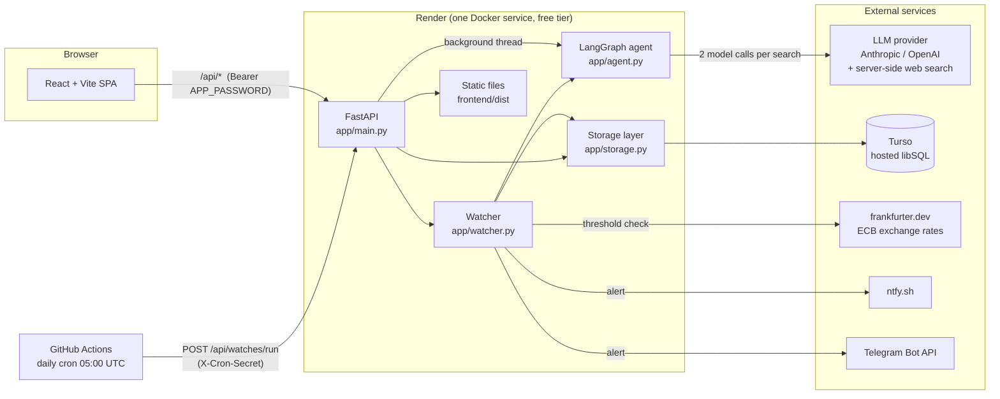
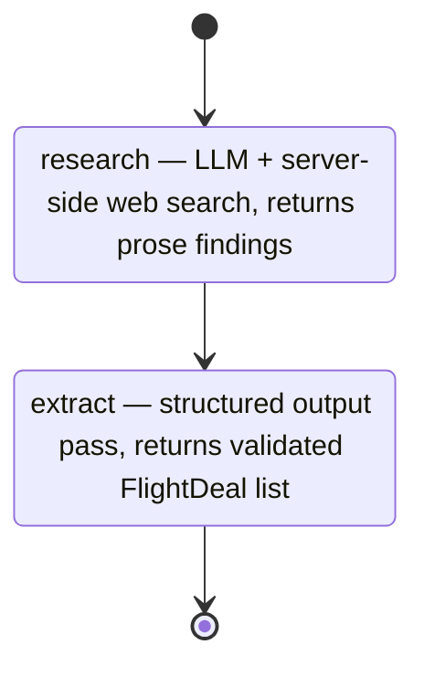
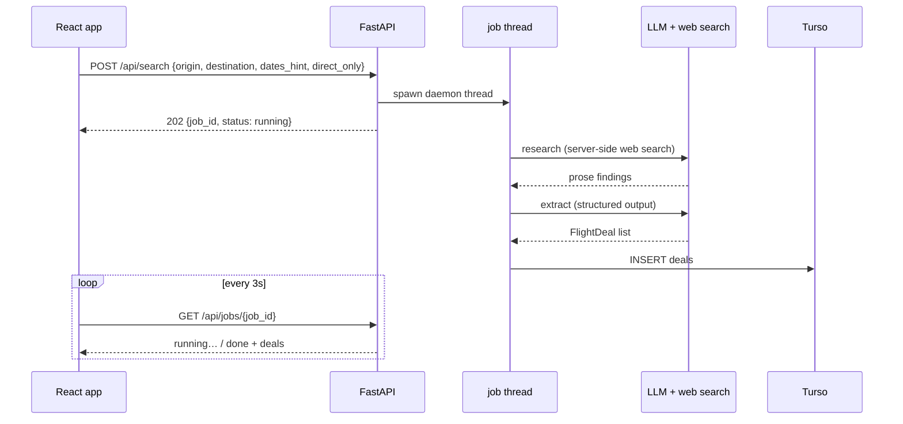
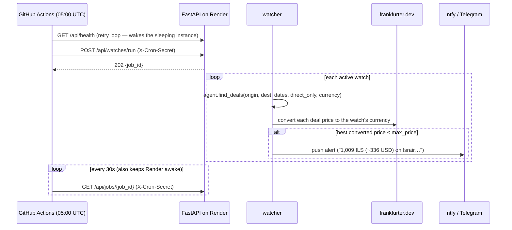

# Flight Scout — Architecture

End-to-end: a LangGraph agent that searches the live web for flight deals, a FastAPI backend that runs it as background jobs and serves the React UI, a Turso (libSQL) database, and a GitHub Actions cron that re-checks watched routes daily and pushes alerts.

## System overview



Everything server-side lives in **one process** on one free Render instance: the API, the agent, the watcher, and the static frontend. There is no queue, no worker fleet, no scraping infrastructure — the design goal is the smallest system that does the job on free tiers.

## The LangGraph agent (`backend/app/agent.py`)

The agent is a two-node `StateGraph`:



State flowing through the graph (`AgentState`):

```python
origin: str            # "TLV"
destination: str       # "Prague"
dates_hint: str        # free text: "October 11 week", "a weekend in November"
direct_only: bool      # constrain to non-stop flights
currency: str          # preferred quote currency (the watch's currency; "USD" default)
research_notes: str    # output of node 1, input of node 2
deals: list[FlightDeal]  # final output
```

### Node 1 — `research`

One LLM call with the provider's **server-side web search tool** bound. The searching loop (issue queries, fetch pages, read results) runs entirely on the provider's infrastructure and the node gets back a single prose answer — no client-side tool loop, no scraper, no flight-API keys:

- **Anthropic**: `{"type": "web_search_20260209", "name": "web_search", "max_uses": 8}`
- **OpenAI**: `{"type": "web_search"}` — requires the Responses API (`ChatOpenAI(use_responses_api=True)`)

The prompt asks for concrete deals (price + currency, airline, dates, duration, stops, booking/source URLs, caveats) from Google Flights result pages, airline deal pages, and fare aggregators. Two conditional clauses are injected from state: a hard "only DIRECT (non-stop) flights" instruction when `direct_only` is set, and a preferred quote currency.

### Node 2 — `extract`

A second, cheaper LLM pass over the research notes using LangChain's `with_structured_output(FlightDealList)` — the model is forced to emit the Pydantic schema, so the output is validated data, not parsed prose. Two safety nets sit on top of the model:

- **Direct-only is enforced in code**: when `direct_only` is set, deals with `stops != 0` are filtered out after extraction. The prompt asks; the filter guarantees.
- **Currency codes are normalized by a Pydantic validator** on `FlightDeal` (`"₪"` → `ILS`, `"$"` → `USD`, ...). The same model validates rows read back from the DB, so old mis-coded rows heal on read.

### Why two passes?

A single call can't reliably do both jobs: web search needs a free-form response the model can reason in, while storage needs strict schema. Splitting them also means the second pass can run on the same cheap model with no tools bound. A full search costs **two model calls** (~$0.01–0.03 on `gpt-5.4-mini`).

### Provider selection

`_provider()` picks the provider at call time: `FLIGHT_SCOUT_PROVIDER` env override → `ANTHROPIC_API_KEY` present → `OPENAI_API_KEY` present. Default models: `claude-opus-5` / `gpt-5.4-mini`, overridable with `FLIGHT_SCOUT_MODEL`.

## Request flow — what happens on "Find deals"

A live web search takes 1–2 minutes, far beyond sane HTTP timeouts (and Render's proxy limits), so searches run as **background jobs**:



Jobs live in an in-memory dict guarded by a lock — fine for a single instance; a restart loses in-flight jobs but never stored data. The same mechanism runs watch sweeps (`kind: watch_run`).

## Storage (`backend/app/storage.py`)

Two interchangeable backends behind one module — both speak the sqlite3 DB-API:

| | Local dev | Production |
|---|---|---|
| Backend | SQLite file (`backend/flight_scout.db`) | [Turso](https://turso.tech) hosted libSQL |
| Selected by | `TURSO_DATABASE_URL` unset | `TURSO_DATABASE_URL` + `TURSO_AUTH_TOKEN` set |
| Why | zero setup | Render free tier has an **ephemeral disk** — a local file would vanish on every deploy/restart |

Two tables: `deals` (every deal from every run, append-only) and `watches`. Schema is created on first connect; lightweight migrations are `ALTER TABLE` statements that fail harmlessly once applied.

Performance shape (matters because every Turso statement is a network round trip):

- **One pooled connection per process**, serialized by a lock (writes happen on job threads while requests read). Schema DDL runs once per process, not per request. A dropped idle connection is detected and retried once on a fresh connection — note that libsql surfaces dead-connection errors as a `BaseException`-derived pyo3 panic, which the retry deliberately catches.
- **60-second in-process read cache** over deals/watches/history, invalidated wholesale by every write — so the UI sees fresh data the instant a search or watch run lands. Before this, a page load cost ~24 Turso round trips (~5s); warm loads now cost zero.

Read-time shaping (the DB stays raw; views are computed):

- **De-duplication**: identical deals re-found across runs (same route/airline/dates/price) collapse into one row carrying `times_seen` and `first_found_at`. A *changed* price is deliberately a new entry — repricing is information.
- **Price history**: deals group by the *requested* route parsed from the search query (extracted deals name airports LTN/LHR/London inconsistently), each run contributes its minimum price, and every price is **converted to the route's dominant currency** first — runs quote whatever currency the source pages used.

## Watches, cron, and notifications



- The **threshold comparison is currency-aware** (`app/currency.py`): deal prices convert into the watch's currency using ECB rates from frankfurter.dev (keyless, cached in-process for 12h) with a static fallback table. Raw-number comparison was the original design and it failed both ways: ₪1,009 vs a $300 threshold never alerted; £95 vs a $100 threshold would have alerted wrongly.
- Alerts go to **every configured channel**: ntfy (topic-based, zero signup) and/or a Telegram bot.
- The workflow's wake-then-poll pattern exists because the free Render instance sleeps after ~15 idle minutes.

## Serving & security

- FastAPI serves the **built React app** as static files from the same port (`STATIC_DIR`, mounted after the API routes) — one service, one URL, no CORS in production.
- When `APP_PASSWORD` is set, every data endpoint requires `Authorization: Bearer <password>` (the UI shows a lock screen and stores the password in `localStorage`). The cron path authenticates with `X-Cron-Secret` instead. Comparisons use `secrets.compare_digest`. `/api/health` stays open for Render's health checks.
- Docker image is multi-stage: `node:22-alpine` builds the frontend, `python:3.12-slim` + [uv](https://docs.astral.sh/uv/) runs the backend. (Building locally on Apple Silicon needs `--platform linux/amd64` — the `libsql` wheel is amd64-only.)

## Free-tier constraints that shaped the design

| Constraint | Consequence in the design |
|---|---|
| Render free instance sleeps after ~15 min | cron workflow wakes it and polls every 30s to keep it awake during runs |
| Render free disk is ephemeral | Turso for persistence; in-memory jobs are acceptable losses |
| Turso round trips are ~200ms from Render | pooled connection, once-per-process DDL, 60s read cache |
| Single instance, no queue | background jobs are daemon threads + an in-memory dict |
| LLM spend per search | mini-tier model, two calls per search, watches run sequentially once a day |
